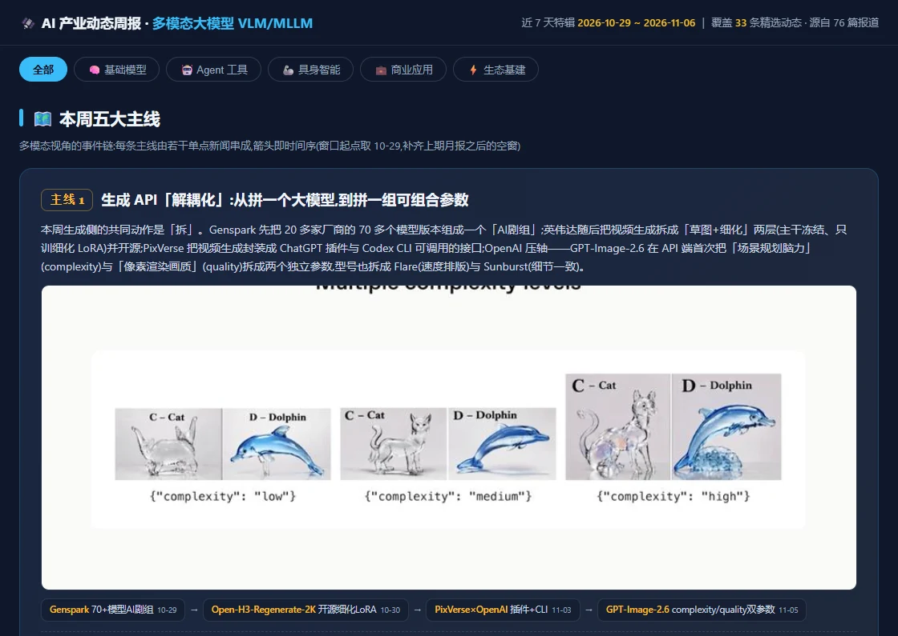
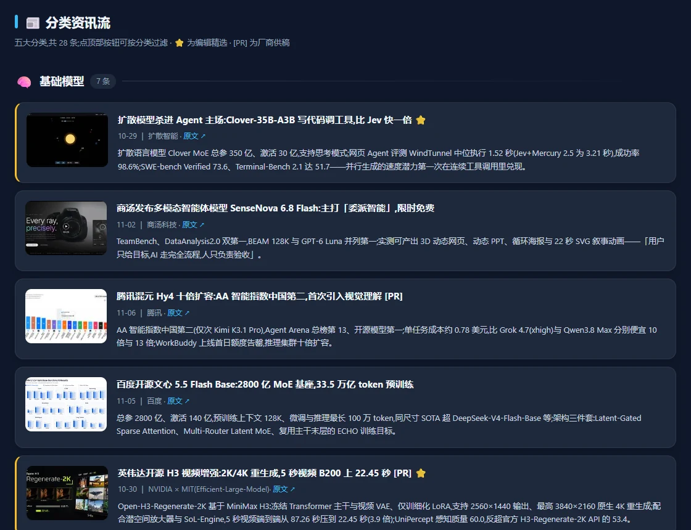

# 多模态 AI 周报：33 条资讯，先看哪 5 条？

把多模态大模型更新整理成一份可以快速浏览、按方向筛选、点回原文的 **单文件 HTML 周报**。仓库里有两份可复用的 Skill，以及一份用它们整理的原版报告。

**[打开原版 HTML 文件页 →](sample/index.html)**  
在文件页点 **Download raw file**，保存后用浏览器打开。示例无需安装依赖，可以离线阅读；点开原文链接时需要联网。

## 这份示例里有什么？

这期历史报告覆盖 **2026.10.29–11.06**，从 76 篇报道中整理出 33 条资讯。

- **先看趋势：** 5 条主线串起本期变化，再用 Top 5 指出值得优先读的内容。
- **按方向找内容：** 用页面顶部按钮筛选基础模型、Agent 工具、具身智能、商业应用和生态基建。
- **需要时回查：** 卡片保留来源链接和相关配图；报告保留了原有的 41 张内嵌图片。

展开：看看分类资讯流

## 两份 Skill 怎么分工？

| Skill | 用途 |
| --- | --- |
| [多模态报告](vlm-monthly-report/SKILL.md) | 定时间窗、读来源原文、筛选条目、写摘要并生成 HTML |
| [HTML 配图规范](html-image-standards/SKILL.md) | 规划配图、检查图文是否对应、核对图片和链接 |

把两份 Skill 交给 Codex 或 Claude Code，给出起止日、信源和输出位置。可以从这条指令开始：

> 读取这两份 SKILL.md，基于可核验的原文整理过去 7 天的多模态模型动态。保留来源链接，标注评测条件、灰测和待核实信息，最后输出为单文件 HTML。

生成新报告时通常需要联网获取原文和可用配图。图片处理示例用到 Python、requests 和 Pillow；视觉模型审图需使用自己的可用配置。
